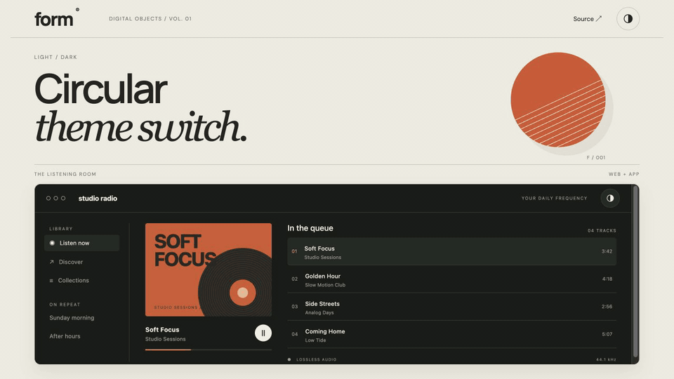

# Circular Theme Switch

A circular dark/light reveal that expands from your click. Zero runtime dependencies.



[**Live demo →**](https://mlemors.github.io/circular-theme-switch/demo/)

## Use it

```sh
npm install github:mlemors/circular-theme-switch#v1.1.2
```

```js
import { createThemeToggle } from '@mlemors/circular-theme-switch';
import '@mlemors/circular-theme-switch/style.css';

const theme = createThemeToggle();
document.querySelector('#theme-button').addEventListener('click', e => theme.toggle(e));
```

Add a button with `id="theme-button"` and an accessible label. Style your theme with the root `.dark` and `.light` classes:

```css
:root.dark { color-scheme: dark; background: #191b19; color: #eeeee7; }
:root.light { color-scheme: light; background: #faf8f1; color: #292d26; }
```

500 ms in both directions. Keyboard clicks start at the button center. Reduced-motion preferences and unsupported browsers switch instantly.

[Vue guide](docs/vue.md) · [React guide](docs/react.md) · [API reference](docs/api.md)

## Run the demo locally

```sh
git clone https://github.com/mlemors/circular-theme-switch.git
cd circular-theme-switch
npm run demo
```

Open `http://localhost:4173/demo/`. Website and embedded app have independent switches.

MIT · [License](LICENSE)
